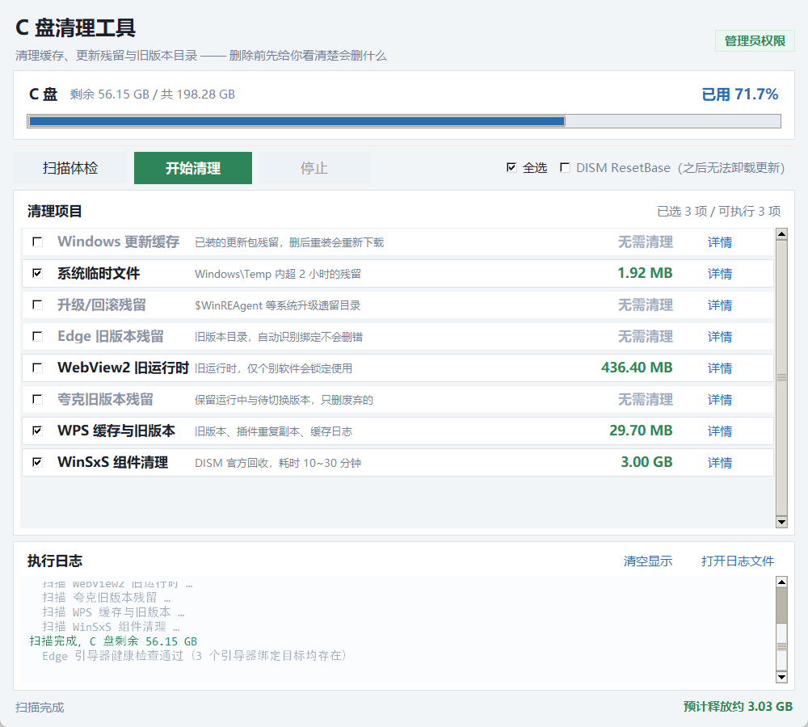

# CleanCDrive — Windows C 盘清理工具

一个带图形界面的 Windows 磁盘清理工具。核心设计原则：**扫描永远只读，删除前必须确认，判定逻辑宁可少删不可错删。**

不是又一个"一键清理"——它只处理有明确归属的残留文件，并且对每一个删除目标都做了来源交叉验证。



## 它清理什么

8 个独立模块，每一项都先扫描出**真实占用**再让你勾选：

| 模块 | 内容 | 需要管理员 |
|---|---|---|
| Windows 更新缓存 | 已安装完毕的更新包残留（`SoftwareDistribution\Download`） | 是 |
| 系统临时文件 | `Windows\Temp` 中超过 2 小时的文件 | 是 |
| 升级/回滚残留 | `$WinREAgent`、`$SysReset`、`$Windows.~BT` 等 | 是 |
| Edge 旧版本残留 | 升级后遗留的旧版本目录（按 SxS 绑定判定，见下） | 是 |
| WebView2 旧运行时 | 旧版 WebView2 运行时，默认**不勾选** | 是 |
| 夸克旧版本残留 | 多版本并存时删除废弃版本 | 是 |
| WPS 缓存与旧版本 | 旧版本目录 + 插件池重复版本 + 缓存日志 | 否 |
| WinSxS 组件清理 | DISM 官方组件回收，约 10~30 分钟 | 是 |

## 安全设计

这些规则不是在文档里写的承诺，而是代码里实际拦截的逻辑。

### 1. Edge 旧版本判定不看版本号高低

这是最容易踩的坑。`Microsoft\Edge\Application\msedge.exe` 并不是"启动最高版本目录"，而是通过 Side-by-Side 清单**硬绑定**某一个具体版本目录：

```
msedge.exe → <assemblyIdentity name="157.0.4341.42" version="157.0.4341.42"/>
```

如果那个版本目录被当成"旧版本残留"删掉，Edge 会永久无法启动，而且**更新流程也无法自我修复**——因为新引导器 `new_msedge.exe` 的替换动作需要旧引导器能跑起来才会触发。

所以 `cleaner_core.py` 的做法是：解析每个引导器内嵌的 SxS 清单，读出它绑定的版本号，然后保护三个来源的并集：

- 所有引导器（`msedge.exe` / `new_msedge.exe` / `msedge_proxy.exe` / `new_msedge_proxy.exe` / `pwahelper.exe` / `new_pwahelper.exe`）绑定的版本
- `User Data\Last Version` 记录的当前运行版本
- 每个版本目录内的最高版本

删除完成后还会跑一次健康检查：逐个校验引导器的绑定目标是否仍然存在，缺失会直接在日志里告警。

### 2. WPS 自动备份永不进入删除计划

`office6\backup` 是崩溃恢复副本，里面可能是你唯一没存盘的版本。代码里对它只做大小统计，不做任何删除操作。

### 3. 夸克的保留版本从四个来源交叉验证

`Last Version` 文件、注册表 `DisplayVersion`、根目录主程序 FileVersion、运行进程的路径——任何一个来源都可能过期或错误（实测遇到过注册表写着 7.5.0 但实际运行 7.4.7 的情况），所以取并集保护。

### 4. 2 小时内变动过的版本目录一律跳过

防止刚升级完成、还没走完切换流程的版本被误删。

### 5. 不杀进程

相关程序正在运行时，被占用的文件自动跳过，不会强制关闭你正在使用的软件。

## 运行

需要 Python 3.8+（含 tkinter，Windows 官方安装包默认自带）。

```
双击「启动 C盘清理工具.cmd」
```

或用命令行：

```bat
python CleanCDrive.pyw
```

提权：界面顶部有黄色提示条时点「以管理员身份重启」，会弹 UAC 确认。管理员权限下才能处理 `Program Files` 和 `Windows` 下的目标。

### 只扫描不删除

```bat
python cleaner_core.py --scan
```

只打印清单，不做任何修改。

## 文件说明

```
CleanCDrive/
├── cleaner_core.py           清理引擎：所有扫描、判定、删除逻辑
├── CleanCDrive.pyw           tkinter 图形界面
├── 启动 C盘清理工具.cmd       双击入口（调用 pythonw，不弹控制台）
├── app.ico                   图标
├── README.txt                面向使用者的说明
├── preview-user.png          普通权限界面
└── preview-admin.png         管理员权限界面
```

`cleaner_core.py` 不依赖 GUI，可以单独 import 或用 `--scan` 当命令行工具跑。

## 已知限制

- **未做系统还原点自动创建**。动手前建议自行创建还原点。
- **WinSxS 清理默认不启用 ResetBase**。启用后能多回收 1~2 GB，但会失去卸载已安装更新的能力。
- **依赖目录结构的假设**。Edge / 夸克 / WPS 的内部布局可能随版本变化，判定逻辑基于当前观测到的结构；遇到未匹配的结构会保守跳过而不是报错删除。
- **仅测试于 Windows 11 Build 26300**。

## License

MIT
